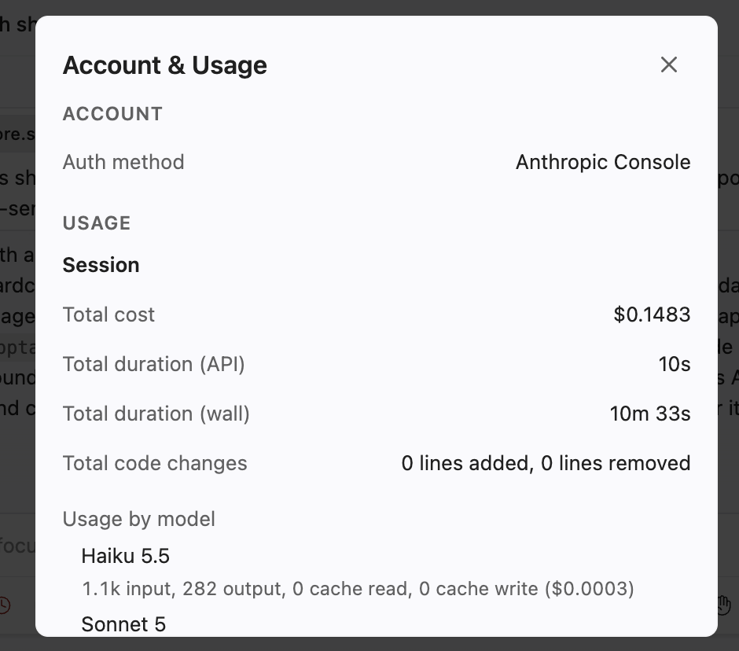

```{=html}
```

# GA4 answers - Chandrima Das

------------------------------------------------------------------------

## Part A: Your project dir and Git repo

### 1: Create subdirs, and copy `CLAUDE.md` and a FastQC report

<!-- No command/output needed. -->

### 2: Initialize a Git repository, and commit your first files

<!-- No command/output needed here -- we check the repo directly. -->

------------------------------------------------------------------------

## Part B: A TrimGalore script --- without genAI

<!-- Reminder: no genAI in this Part! -->

### 3: A TrimGalore container, its help info, and three options

*Answer*: The container link (URI) is:[community.wave.seqera.io/library/trim-galore:2.3.0--2b255ff43100a747](oras://community.wave.seqera.io/library/trim-galore:2.3.0--dfb1fd48e19a6cf3)

Code to run `trim_galore --help` with the container:

``` bash
apptainer exec oras://community.wave.seqera.io/library/trim-galore:2.3.0--a56e49e832976df4 \
    trim_galore --help
```

<!-- You don't need to paste the TrimGalore help output -->

*Answer*: The option to indicate that the reads are paired-end: `--paired`

*Answer*: The option to set the output dir: `-o` or `--output_dir`

*Answer*: The option to run FastQC on the trimmed FASTQ files: `--fastqc`

### 4: Default thresholds

*Answer*: A) The default base quality score threshold: `20`

*Answer*: B) The default read length threshold: `20bp`

### touch scripts/trimgalore.sh5: Write the `trimgalore.sh` script

<!-- No need to paste the script: we'll look at scripts/trimgalore.sh directly. -->

### 6: Run the script for sample `S63`, and check the output files

Code to run the script:

``` bash
bash scripts/trimgalore.sh \
    ../garrigos/fastq/S63_R1.fastq.gz \
    ../garrigos/fastq/S63_R2.fastq.gz \
    results/trimgalore
```

<!-- You don't need to paste the TrimGalore logging output -->

Code to list the output files:

``` bash
ls results/trimgalore
```

The output of the command was:

```         
[carbohydrate21@p0220 GA4]$ ls results/trimgalore
S63_R1.fastq.gz_trimming_report.json  S63_R1_val_1_fastqc.html  S63_R1_val_1.fq.gz                    S63_R2.fastq.gz_trimming_report.txt  S63_R2_val_2_fastqc.zip
S63_R1.fastq.gz_trimming_report.txt   S63_R1_val_1_fastqc.zip   S63_R2.fastq.gz_trimming_report.json  S63_R2_val_2_fastqc.html             S63_R2_val_2.fq.gz
```

*Answer*: What each type of output file contains: The `.fq.gz` files contain the trimmed R1 and R2 sequencing reads. The `_trimming_report.txt` files contain human-readable summaries of the trimming results, while the `.json` files contain the trimming results in a structured format. The `_fastqc.html` files are the FastQC reports for viewing the quality of the trimmed reads, and the `_fastqc.zip` files contain the underlying FastQC result files.

<!-- If your script failed at first: describe the problem and your fix here. -->

### 7: Trimming results

*Answer*: Which adapter sequence TrimGalore looked for, and how it decided on this: Which adapter sequence TrimGalore looked for, and how it decided on this: TrimGalore looked for the Illumina adapter sequence `AGATCGGAAGAGC`. I did not specify an adapter, so TrimGalore auto-detected the adapter type from the reads. It detected the Illumina adapter, while the second-best match, Nextera, had no hits.

*Answer*: Percentage of reads with adapters in R1 and R2: `13.0%` in R1 and `10.1%` in R2.

*Answer*: In R1 and R2, were more bases removed by quality trimming or by adapter trimming?

More bases were removed by quality trimming in both files. In R1, 1,274,150 bases were removed by quality trimming compared with about 85,527 bases by adapter trimming. In R2, 1,283,793 bases were removed by quality trimming compared with about 60,540 bases by adapter trimming.

*Answer*: Percentage of read pairs that were removed: `7.4%`

### 8: Poly-G trimming

*Answer*: Did TrimGalore do poly-G trimming, and did you have to tell it to?

Yes. TrimGalore performed poly-G trimming automatically. I did not have to specify the `--poly_g` option because TrimGalore detected the poly-G pattern in the reads and enabled trimming on its own.

*Answer*: What TrimGalore concludes about the sequencing technology:

TrimGalore concluded that the reads are consistent with two-color Illumina sequencing chemistry, such as NovaSeq or NextSeq, because it detected poly-G tails characteristic of this type of sequencing.

*Answer*: Was more poly-G trimming done in R1 or R2? (Optional: any idea why?)

More poly-G trimming was done in R2. In R1, 11,919 reads (2.4%) had poly-G trimming, removing 90,248 bases. In R2, 43,397 reads (8.7%) were trimmed, removing 1,187,383 bases. One possible reason is that R2 reads often show poorer quality toward the end of the read, which could make the two-color sequencing artifact more apparent in R2.

### 9: Compare the FastQC reports before and after trimming

*Answer*: At least two differences between the reports, and whether things look better in terms of pass/warn/fail status:

After trimming, the quality toward the ends of the reads improved and the adapter content was reduced. The sequence length distribution also changed because trimming produced reads of different lengths instead of mostly the original read length. Overall, the trimmed reads look better in terms of FastQC pass/warn/fail status, although the sequence length distribution can still show a warning because the reads now have variable lengths after trimming.

*Answer*: Were the short reads with only `N`s removed? If so, was that due to the length threshold, or something else?

The short `N`-only reads appear to have been removed. This was not due to an N-content filter, because the TrimGalore report showed that 0 reads were removed for having too many `N` bases. Instead, the reads were trimmed and then became shorter than the 20-bp minimum length threshold, causing them to be removed.

*Answer*: Something you didn't expect or are confused about:git add scripts/trimgalore.sh git commit -m "Add TrimGalore script"

I did not expect the sequence length distribution to still show a warning after trimming. I initially thought trimming would make all of the FastQC results improve, but I realized that trimming makes the reads different lengths, so this warning does not necessarily mean the data quality became worse.

------------------------------------------------------------------------

## Part C: Bring in genAI

<!-- Export the conversations for questions 10, 11, 13, and 14 to `doc/ai`. -->

### 10: Sonnet reviews your script

*Answer*: Your prompt:

`Review this shell script. List the 5 most important problems or improvements, most important first, with a one-sentence reason for each. Don’t change it yet.`

*Answer*: Claude's suggestions, and for each, whether you agree, disagree, or don't understand it, and why:

1.  **Add a separate TrimGalore version-report line at the end.** I disagree for this assignment. Although our `CLAUDE.md` generally says to report program versions, the GA4 instructions specifically say that I do not need to print the TrimGalore version separately because TrimGalore prints it automatically when it runs.

2.  **Confirm that FastQC is bundled in the TrimGalore container.** I disagree that this is an important problem here. The TrimGalore help information says that `--fastqc` uses its bundled FastQC implementation, and my script successfully produced the FastQC HTML and ZIP files, so this functionality is already confirmed.

3.  **Add an explicit check that the input FASTQ files exist.** I agree that this could make the script more user-friendly by giving a clearer error before TrimGalore starts. However, the current script already stops on errors because of `set -euo pipefail`, and I would not change it yet because a later question specifically asks us to investigate this type of check.

4.  **Add a comment explaining why TrimGalore version 2.3.0 is hardcoded.** I mostly disagree that this is important. Version 2.3.0 was specifically required by the assignment, and the container is stored as an uppercase constant following our course conventions. A comment could add context, but it is not necessary for the script to work or be reproducible.

5.  **Explicitly bind directories with Apptainer.** I disagree for this workflow. The script already ran successfully using FASTQ files in `../garrigos/fastq`, so OSC's existing Apptainer setup can access the required directories. Adding extra bind options would make the script more complicated without solving a problem I actually encountered.

*Answer*: Was anything wrong, or in conflict with the course's practices? Did Claude refer to your `CLAUDE.md` conventions?

Yes. Claude referred directly to the `CLAUDE.md` convention about reporting the program version. However, in this case the assignment gives a more specific instruction saying that a separate TrimGalore version command is not needed. Some other suggestions, especially adding explicit Apptainer binds, seemed unnecessarily complicated for this course workflow because the script had already run successfully.

*Answer*: The estimated cost of this conversation (from `/usage`):



### 11: Opus reviews your script

*Answer*: The estimated cost of this conversation (from `/usage`): Total cost: \$0.2405 Total duration (API): 20s Total duration (wall): 8m 30s Total code changes: 0 lines added, 0 lines removed Usage by model: claude-haiku-5-5: 1.1k input, 352 output, 0 cache read, 0 cache write (\$0.0003) claude-opus-5-5: 4.0k input, 1.4k output, 33.2k cache read, 37.8k cache write (\$0.2402) Prompt cache (main): 2 requests · 44% of input tokens from cache · 1 miss (last 7m 11s ago, 4.5k tokens re-cached) · cold — idle 7m 11s, next turn re-caches \~37.8k tokens

*Answer*: Which suggestions did only one of the two models make? Sonnet uniquely suggested confirming that FastQC was bundled in the TrimGalore container, documenting why version 2.3.0 was hardcoded, and explicitly binding directories with Apptainer. Opus uniquely suggested checking the number of arguments, renaming TrimGalore's output FASTQ files, adding #SBATCH directives, and placing FastQC output in a separate directory. Both models suggested adding a separate version-report command and checking that the input files exist.

*Answer*: Did either model claim something that you know is wrong? Yes. Both models said that the script should separately run trim_galore --version, but the assignment specifically says this is unnecessary because TrimGalore prints its version automatically. Opus also suggested adding #SBATCH directives, which conflicts with our current course practice because we have not yet learned batch-job submission and are supposed to run these scripts interactively with one core. I also would not rename the TrimGalore output files because the assignment and later analyses use the program's default output names. *Answer*: Did either model check its claims, for example by running commands? Opus read the script but did not run commands to verify its claims. Its /usage output also showed 0 lines added and 0 lines removed, which is consistent with this being a review-only conversation.

*Answer*: Did Opus's review change your mind about any of your answers to question 10? Not substantially. I still agree that checking the input files could improve the clarity of error messages. Opus's suggestion to check the number of arguments also seems reasonable, but several of its other suggestions were either unnecessary for this assignment or conflicted with our course workflow.

*Answer*: How did the costs compare? Which review would you trust more, and why? Was the difference worth the difference in cost? I would not automatically trust Opus more just because it is the more capable model. Opus identified some useful robustness improvements, but it also suggested changes such as #SBATCH directives and renaming output files that do not fit this assignment. I would trust the review that follows the project-specific instructions more closely and checks its claims. Whether the extra cost was worth it depends on how much more useful the Opus suggestions were compared with Sonnet.

### 12: Run the script with a non-existent file

``` bash
 bash scripts/trimgalore.sh \
    ../garrigos/fastq/DOES_NOT_EXIST_R1.fastq.gz \
    ../garrigos/fastq/S63_R2.fastq.gz \
    results/trimgalore
```

The output of the command was:

\`\`\` Starting script trimgalore.sh Sun Oct 25 05:50:26 PM EDT 2026 R1 FASTQ file: ../garrigos/fastq/DOES_NOT_EXIST_R1.fastq.gz R2 FASTQ file: ../garrigos/fastq/S63_R2.fastq.gz Output dir: results/trimgalore

INFO: Using cached SIF image INFO: gocryptfs not found, will not be able to use gocryptfs Error: Input file not found: ../garrigos/fastq/DOES_NOT_EXIST_R1.fastq.gz

```         

*Answer*: What happens, and at which point does the script stop?
The script starts and prints the input file paths and output directory, but it stops when it reaches the TrimGalore command. TrimGalore detects that the R1 FASTQ file does not exist and reports Error: Input file not found. Because the script uses set -euo pipefail, it exits at that point and does not print the final success message.

### 13: Claude adds a check to your script

*Answer*: Your prompt:
In scripts/trimgalore.sh, add a check that both input FASTQ files exist, and exit with an informative error message if they don’t.

``` bash
# Your command to test the updated script: 
bash scripts/trimgalore.sh \
    ../garrigos/fastq/DOES_NOT_EXIST_R1.fastq.gz \
    ../garrigos/fastq/S63_R2.fastq.gz \
    results/trimgalore
```

The output of the command was:

\`\`\`Starting script trimgalore.sh Sun Oct 25 05:57:09 PM EDT 2026 R1 FASTQ file: ../garrigos/fastq/DOES_NOT_EXIST_R1.fastq.gz R2 FASTQ file: ../garrigos/fastq/S63_R2.fastq.gz Output dir: results/trimgalore

Error: R1 FASTQ file not found: ../garrigos/fastq/DOES_NOT_EXIST_R1.fastq.gz

```         

*Answer*: Does it behave the way Claude claimed it would?
Yes. The script detected that the R1 FASTQ file did not exist, printed an informative error message, and stopped before Apptainer or TrimGalore started.

*Answer*: Given what you saw in question 12, how useful is this check?
The check is useful mainly because it makes the error clearer and catches the problem earlier. In question 12, TrimGalore already detected the missing file and stopped the script, so the new check does not prevent a problem that would otherwise go unnoticed. However, it avoids starting the container and tells the user directly which input file is missing.
### 14: Claude writes a loop

*Answer*: Your prompt:
Write a for loop that runs scripts/trimgalore.sh for the 7 samples whose IDs start with S6, with output dir results/trimgalore. I will run the loop from the GA4 dir. Only show me the loop: don’t add it to a file, and don’t run it.

The loop that Claude wrote:

``` bash
awk -F'\t' 'NR==1{for(i=1;i<=NF;i++)print i,$i; exit}' ../garrigos/meta/metadata.tsv

cut -f1 ../garrigos/meta/metadata.tsv | grep '^S6'

for sample in S63 S64 S65 S66 S67 S68 S69; do
    bash scripts/trimgalore.sh ../garrigos/fastq/${sample}_R1.fastq.gz ../garrigos/fastq/${sample}_R2.fastq.gz results/trimgalore
done


# Paste Claude's loop here
for sample in S63 S64 S65 S66 S67 S68 S69; do
    bash scripts/trimgalore.sh ../garrigos/fastq/${sample}_R1.fastq.gz ../garrigos/fastq/${sample}_R2.fastq.gz results/trimgalore
done
```

*Answer*: Does it run the script once per sample?

Yes. The loop goes through the seven sample IDs one at a time, so `scripts/trimgalore.sh` is run once for each sample.

*Answer*: Does it get the correct R2 file for each R1 file?

Yes. For each sample ID, the loop constructs both the R1 and R2 file names using the same sample name. For example, for `S63` it uses `S63_R1.fastq.gz` and `S63_R2.fastq.gz`.

*Answer*: Does it only run for the 7 `S6` samples?

Yes. The loop explicitly lists `S63 S64 S65 S66 S67 S68 S69`, so it only runs for those seven samples.

*Answer*: Did you change the loop? If so, what did you change and why?

No. I did not change the loop because it already ran once per sample, paired the correct R1 and R2 files, and was restricted to exactly the seven required samples.

### 15: Test and run the loop

The loop with `echo`, to test it:

``` bash
# Your loop: 
for sample in S63 S64 S65 S66 S67 S68 S69; do
    bash scripts/trimgalore.sh ../garrigos/fastq/${sample}_R1.fastq.gz ../garrigos/fastq/${sample}_R2.fastq.gz results/trimgalore
done
```

The output of the loop was:

```         
```

<!-- You don't need to paste the output of the loop that ran TrimGalore -->

``` bash
# Your command(s) to check the output files:
ls results/trimgalore/*_val_1.fq.gz
ls results/trimgalore/*_val_2.fq.gz
```

The output of the command(s) was:

```         
[carbohydrate21@p0220 GA4]$ ls results/trimgalore/*_val_1.fq.gz
results/trimgalore/S63_R1_val_1.fq.gz  results/trimgalore/S65_R1_val_1.fq.gz  results/trimgalore/S67_R1_val_1.fq.gz  results/trimgalore/S69_R1_val_1.fq.gz
results/trimgalore/S64_R1_val_1.fq.gz  results/trimgalore/S66_R1_val_1.fq.gz  results/trimgalore/S68_R1_val_1.fq.gz
[carbohydrate21@p0220 GA4]$ ls results/trimgalore/*_val_2.fq.gz
results/trimgalore/S63_R2_val_2.fq.gz  results/trimgalore/S65_R2_val_2.fq.gz  results/trimgalore/S67_R2_val_2.fq.gz  results/trimgalore/S69_R2_val_2.fq.gz
results/trimgalore/S64_R2_val_2.fq.gz  results/trimgalore/S66_R2_val_2.fq.gz  results/trimgalore/S68_R2_val_2.fq.gz
```

*Answer*: Are all 7 samples represented?

Yes. All 7 samples, S63 through S69, are represented in both the trimmed R1 and trimmed R2 output files.

### 16: A summary command

*Answer*: Your prompt:

``` bash
# The command you got from Claude:
for f in results/trimgalore/*_R2.fastq.gz_trimming_report.txt; do
    sample=$(basename "$f" _R2.fastq.gz_trimming_report.txt)
    pct=$(grep "Number of sequence pairs removed" "$f" | grep -o '[0-9.]*%')
    echo "$sample: $pct"
done
```

The output of the command was:

```         
S63: 7.40%
S64: 3.35%
S65: 1.94%
S66: 3.71%
S67: 1.78%
S68: 2.56%
S69: 4.81%
```

*Answer*: Did the output look right? If not, what did you do?

Yes, the output looked right. The first output I copied showed S63 through S68, so I checked the S69 trimming report separately and confirmed that S69 had `4.81%` of read pairs removed.

*Answer*: Does the value for `S63` match your answer to question 7?

Yes. The command reported `7.40%` for S63, which matches the `7.4%` I reported in question 7.

*Answer*: In your own words, how does the command work?

The command loops through the R2 trimming report for each sample. `basename` removes the directory path and the report-file ending to get the sample ID. The first `grep` finds the line reporting the number of sequence pairs removed, and the second `grep` extracts only the percentage. Finally, `echo` prints the sample ID and its percentage.

### 17: Document your genAI use

<!-- No command/output needed here -- we check your `doc/ai` dir in the repo directly. -->

### 18: Update your `CLAUDE.md`

*Answer*: What you added to `CLAUDE.md`, and why:

*Answer*: Did Claude follow the new instruction?

### 19: Reflection

*Answer*:

------------------------------------------------------------------------

## Part D: Publish your repo on GitHub

### 20: Create a GitHub repository, push, and create an Issue

<!-- No command/output needed here -- we check your GitHub repo directly. -->